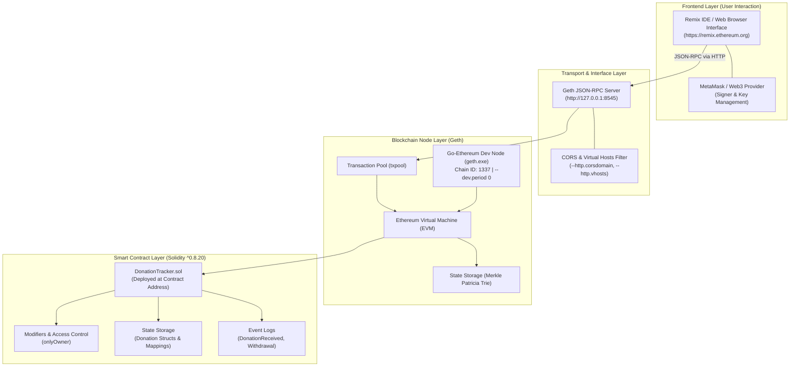

# System Architecture & Technical Design

This document details the architectural design, security model, and transaction lifecycle for the **Blockchain-Based Transparent Donation Tracking System Using Smart Contracts**.

---

## 1. System Architecture Diagram



---

## 2. Comparison: Traditional Model vs. Blockchain Model

### Traditional Centralized Model

```
   +----------+        Funds (Fiat)         +----------------------+
   |  Donor   | --------------------------> | Centralized Database |
   +----------+                             |  (Private SQL DB)    |
                                            +----------------------+
                                                       |
                                            Admin Edit / Delete Permitted
                                                       |
                                                       v
                                            +----------------------+
                                            |   Opaque Spending    |
                                            |  (Internal Records)  |
                                            +----------------------+
```

**Flaws in Traditional Systems:**
1. **Single Point of Control / Failure**: The database is fully owned and operated by the charity or NGO.
2. **Mutable History**: Database administrators can modify, backdate, or delete donation entries without detection.
3. **Lack of Verifiable Public Audit**: Donors must blindly trust financial reports compiled by the organization itself.
4. **No Cryptographic Proof**: Donors receive paper or PDF receipts that are easy to fabricate.

---

### Proposed Smart-Contract Model

```
   +----------+        Crypto (ETH)         +----------------------+
   |  Donor   | --------------------------> | DonationTracker.sol  |
   +----------+                             |   (Smart Contract)   |
                                            +----------------------+
                                                       |
                                         Rules Enforced by EVM Consensus
                                                       |
                                                       v
                                            +----------------------+
                                            |  Local Geth Ledger   |
                                            |  (Immutable Blocks)  |
                                            +----------------------+
                                                       |
                                                       v
                                            +----------------------+
                                            | Public Event Stream  |
                                            | (Verifiable Audit)   |
                                            +----------------------+
```

**Improvements in the Smart-Contract Model:**
1. **Decentralized / Independent Verification**: Anyone can connect to the blockchain RPC and query donation records directly.
2. **Immutable Recordkeeping**: Once a block is mined into the blockchain, transaction data cannot be altered or deleted by anyone, including the contract deployer.
3. **Cryptographic Identity**: The donor's unique Ethereum address (`msg.sender`) is permanently attached to the donation record, preventing identity impersonation.
4. **Programmable Escrow & Withdrawal Guard**: Funds are locked inside the smart contract until an authorized withdrawal transaction is executed by the designated admin, leaving a permanent audit trail on-chain.

---

## 3. Realistic Understanding of Transparency & Limitations

An important academic standard for this project is to maintain scientific realism:

> [!IMPORTANT]
> **What Blockchain Guarantees:**
> - **Inflow Integrity**: Verifies exactly who donated, what amount was donated, when it was sent, and what purpose was specified.
> - **Custody Transparency**: Verifies exactly how much funds the smart contract currently holds at any instant.
> - **Withdrawal Attribution**: Logs precisely when and to which account funds are withdrawn from the contract.

> [!CAUTION]
> **What Blockchain CANNOT Guarantee (The Oracle / Real-World Boundary):**
> - The blockchain controls digital currency inside the EVM. Once the NGO/admin withdraws the Ether to their external wallet or converts it to fiat to purchase physical goods (e.g., buying medicine, textbooks, or food supplies), the blockchain cannot physical monitor real-world vendor transactions.
> - Therefore, blockchain solves the **collection, attribution, custody, and initial withdrawal tracking problem**, eliminating hidden centralized accounting modifications.

---

## 4. Donation Lifecycle & State Transitions

```
[Donor Action]
      |
      | 1. Calls donate("Education") with 0.10 ETH attached
      v
[Checks Phase]
      |-- msg.value > 0? (If 0 -> Revert with DonationMustBeGreaterThanZero)
      |-- bytes(purpose).length > 0? (If empty -> Revert with EmptyPurpose)
      v
[Effects Phase]
      |-- totalDonations incremented (e.g. 0 -> 1)
      |-- totalAmountDonated incremented (+ 0.10 ETH)
      |-- _donations[id] populated with (id, donor, amount, purpose, timestamp)
      v
[Log Emission Phase]
      |-- emit DonationReceived(id, donor, amount, purpose, timestamp)
      v
[Receipt Generation]
      |-- Transaction confirmed in Geth block
      |-- EVM returns newDonationId to caller
```

---

## 5. Security Architecture & Threat Mitigation

| Threat Vector | Mitigation in `DonationTracker.sol` |
| :--- | :--- |
| **Unauthorized Withdrawal** | Protected by the `onlyOwner` modifier; unauthorized callers immediately revert with `OnlyOwnerAllowed()`. |
| **Reentrancy Attack** | State updates and event emissions precede external Ether transfer. The contract utilizes standard Checks-Effects-Interactions (CEI). |
| **Zero-Value Spam** | Guard statement rejects `msg.value == 0`, preventing zero-cost state pollution. |
| **Unlabeled Transfers** | The `receive()` and `fallback()` functions explicitly revert direct plain transfers, requiring callers to specify a `purpose` via `donate()`. |
| **Zero-Address Ownership Loss** | `transferOwnership` strictly validates `newOwner != address(0)`. |
| **Unbounded Gas Loops** | The contract uses a sequential key-value mapping (`mapping(uint256 => Donation)`) instead of unbounded dynamic arrays for state lookups. |
